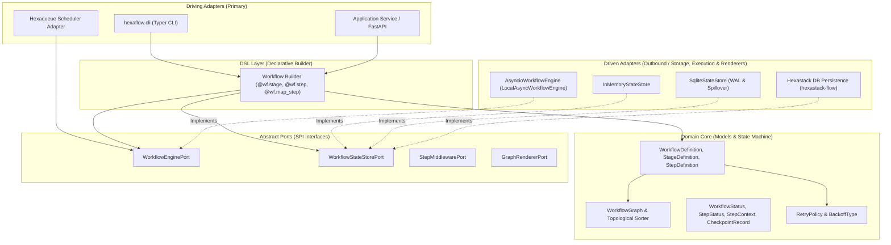
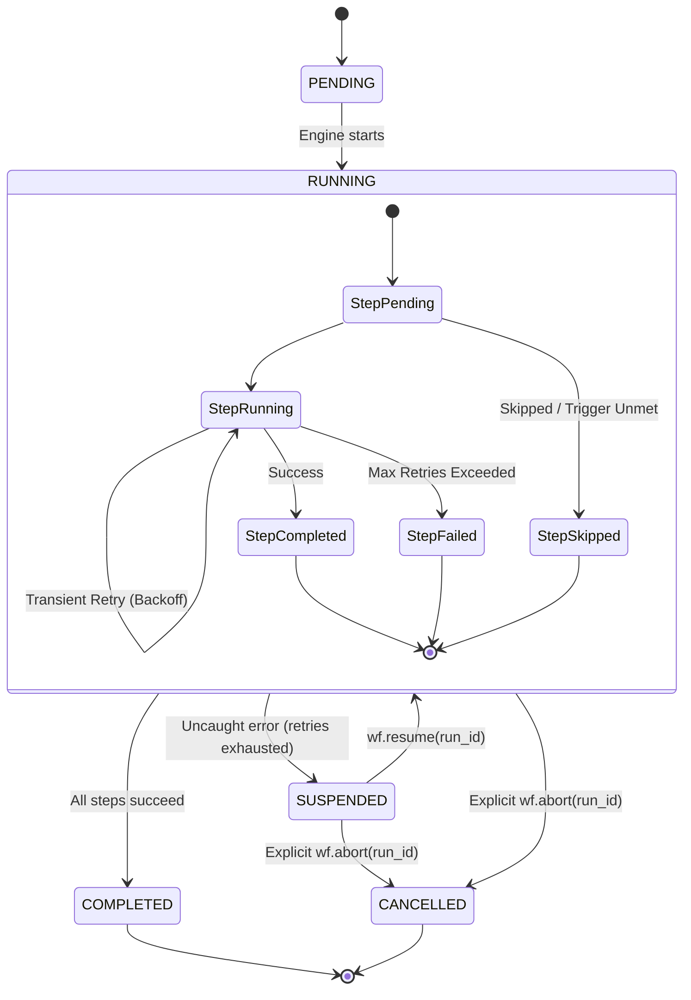
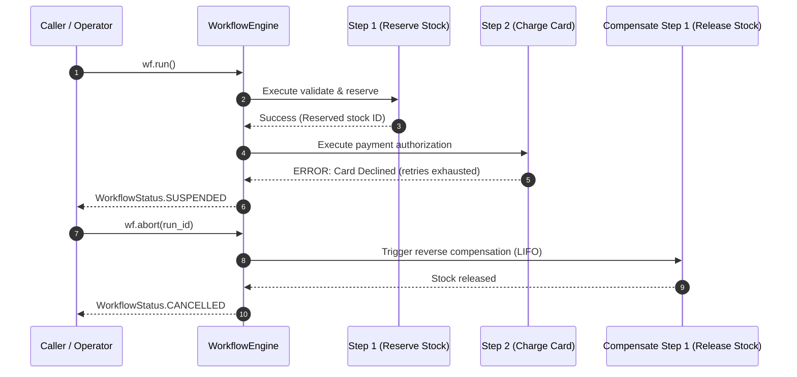

# 🏛️ Hexaflow Architecture & Design

> **Architectural Intent**: Hexaflow follows strict Hexagonal Architecture (Ports and Adapters). It separates the pure DAG domain and state machine from execution engines and storage implementations.

---

## 1. Hexagonal Layers & Boundaries

The codebase is organized into concentric layers with strict inward dependency flow:



### Layer Responsibilities

1. **Domain (`hexaflow.domain`)**:
   - Immutable Pydantic v2 models (`WorkflowDefinition`, `StageDefinition`, `StepDefinition`, `StepContext`, `CheckpointRecord`, `WorkflowExecutionState`, `WorkflowMemento`), enums (`WorkflowStatus`, `StepStatus`, `TriggerRule`, `StageExecutionMode`, `ExecutionPool`, `BackoffType`), and `RetryPolicy` (`NamedTuple`).
   - Contains no database drivers, no async runtimes, and no subprocess logic.

2. **Ports (`hexaflow.ports`)**:
   - `WorkflowEnginePort` (ABC): Defines execution contracts (`run`/`run_async`, `resume`/`resume_async`, `rewind`/`rewind_async`, `restart`/`restart_async`, `abort`/`abort_async`, `close`/`aclose` returning `WorkflowExecutionState`).
   - `WorkflowStateStorePort` (ABC): Defines persistence contracts (`save_run`, `get_run`, `save_checkpoint`, `get_checkpoint`, `get_checkpoints`, `clear_checkpoints`, `delete_checkpoint`).
   - `StepMiddlewarePort` (Protocol) & `GraphRendererPort` (ABC): Interception hooks and graph output contracts.

3. **Adapters (`hexaflow.adapters`)**:
   - `adapters.engines.local_async`: `AsyncioWorkflowEngine` (aliased as `LocalAsyncWorkflowEngine`) utilizing `asyncio` task groups and topological scheduling.
   - `adapters.storage.in_memory`: Ephemeral `InMemoryStateStore` dictionary store for zero-I/O unit tests.
   - `adapters.storage.sqlite`: WAL-mode `SqliteStateStore` with local spillover for large payloads.
   - `adapters.middleware` & `adapters.renderers`: Logging/timing/mock interceptors and Mermaid, DOT, ASCII, JSON renderers.

4. **DSL (`hexaflow.dsl`)**:
   - Declarative decorator API (`@wf.stage`, `@wf.step` with `depends_on`/`is_split`/`compensation`, and `@wf.map_step`) constructing validated `WorkflowDefinition` DAGs.

---

## 2. State Machine Lifecycle

Workflows and steps adhere to an explicit finite state machine:



### Execution Statuses

- **`PENDING`**: Workflow or step is registered and awaiting execution dependencies.
- **`RUNNING`**: Active execution in progress.
- **`SUSPENDED`**: Workflow halted after a step error exceeding retry thresholds, preserving completed checkpoints for resumption or explicit abort.
- **`COMPLETED`**: Execution finished successfully; outputs are persisted in state checkpoints.
- **`CANCELLED`**: Workflow aborted via `wf.abort(run_id)` or `hexaflow abort` (after unwinding compensations).
- **`FAILED` / `SKIPPED`** *(Step-level `StepStatus`)*: Individual step terminated with an unhandled error or was bypassed (`skip_steps` / unmet `trigger_rule`).

---

## 3. The Zero-Daemon Invariant

### What Stays in Hexaflow
Hexaflow maintains an uncompromising guardrail: **It will never become an enterprise database suite or require background daemon processes.**
- Built-in storage is strictly limited to `InMemoryStateStore` and `SqliteStateStore`.
- All background execution is thread/process-local or native asyncio.

### Where Advanced Features Live
- **Relational Databases & Redis**: Enterprise PostgreSQL, MySQL, and distributed Redis state stores belong in [**`hexastack-flow`**](https://github.com/TheTrueSCU/hexastack) backed by `hexastack-db`.
- **Multi-Node Cluster Scheduling**: Distributed split/join barriers across remote HPC worker nodes belong in [**`hexaqueue`**](https://github.com/TheTrueSCU/hexaqueue).

---

## 4. Compensation Rollback Mechanics

When business processes cross transactional boundaries, Hexaflow supports compensation handlers declared on steps. If a downstream step fails, the run transitions to `SUSPENDED` and operators or callers explicitly invoke `wf.abort(run_id)` (or `hexaflow abort`) to unwind completed steps in reverse completion order:



Declare compensations via the `compensation=` argument on `@wf.step` or `@wf.map_step` (receiving the forward step's return value via `ctx.output`):

```python
def release_inventory(ctx) -> None:
    res_id = ctx.output["res_id"]
    warehouse.cancel_reservation(res_id)


@wf.step("reserve_inventory", compensation=release_inventory)
def reserve_inventory(ctx) -> dict:
    return {"res_id": "r_101"}
```
