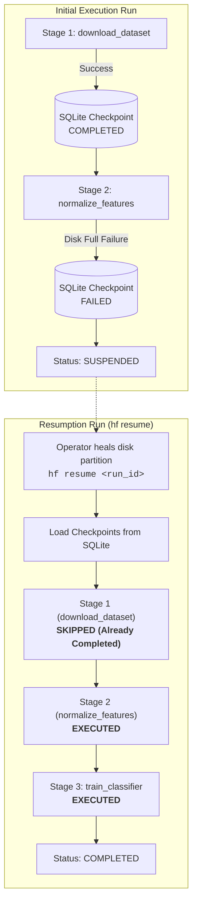

# Memento Checkpoint Resumption & Crash Recovery

> **Architectural Pattern**: Durable, zero-overhead checkpointing into embedded SQLite stores enabling seamless failure recovery and resumption.

---

## 🏛️ Architecture & Resumption Flow

In long-running data pipelines and multi-stage orchestration, failures (disk full, transient network drops, spot instance preemption) must not force re-execution of expensive upstream stages.

Hexaflow implements the **Memento Pattern**:
1. After every successful step execution, step inputs, outputs, timestamps, and execution durations are committed to the configured state store (`SqliteStateStore`).
2. If an exception halts execution, the run is marked `SUSPENDED`, preserving completed checkpoints.
3. Operators inspect the failure reason and traceback using `hexaflow inspect <run_id> <step>`.
4. Resuming with `hexaflow resume <run_id> <target>` loads all prior checkpoints from SQLite, bypassing completed steps and continuing directly from the failed stage.



---

## 💻 CLI Commands

```bash
# 1. Run workflow and observe suspension on worker crash
hf run pipeline.py:ml_pipeline --db .hexaflow/state.db

# 2. Check current status across stages
hf status <run_id> --db .hexaflow/state.db

# 3. Inspect failure exception and traceback
hf inspect <run_id> normalize_features --db .hexaflow/state.db

# 4. Resume execution after fixing worker environment
hf resume <run_id> pipeline.py:ml_pipeline --db .hexaflow/state.db
```

---

## 🎬 Verified Interactive Demo

| Asset | Link |
|---|---|
| **Recording (.webm)** | [`hexaflow-checkpoint-resume.webm`](../assets/demos/hexaflow-checkpoint-resume.webm) |
| **WebVTT Captions** | [`hexaflow-checkpoint-resume.vtt`](../assets/demos/hexaflow-checkpoint-resume.vtt) |
| **Test Suite** | [`tests/e2e/test_cli_resumption.py`](../../tests/e2e/test_cli_resumption.py) |
