# Step Middleware Pipeline & Telemetry

> **Architectural Pattern**: Onion-layered interceptor pipeline wrapping individual step execution with hooks for correlation propagation, metrics, and distributed tracing.

---

## 🏛️ Architecture & Interceptor Stack

Hexaflow provides an onion-layered interceptor architecture matching the Hexastack bus middleware standard.

Middlewares inherit from `InOutStepMiddleware` (or implement `StepMiddlewarePort`), providing three lifecycle hooks:
- `before(ctx)`: Executed before step execution. Returns a context object passed to subsequent hooks.
- `after(ctx, result, context)`: Executed after successful step execution. Can inspect or transform step results.
- `on_error(ctx, exc, context)`: Executed if an exception occurs during downstream processing.

```mermaid
flowchart LR
    CALL["Step Invocation"] --> MW1["CorrelationStepMiddleware<br/><code>before()</code>"]
    MW1 --> MW2["TelemetrySpanStepMiddleware<br/><code>before()</code>"]
    MW2 --> MW3["TimingStepMiddleware<br/><code>before()</code>"]
    MW3 --> ACTION["Step Action Execution<br/><code>ctx.inputs -> output</code>"]
    ACTION --> RET3["TimingStepMiddleware<br/><code>after()</code> (latency_ms)"]
    RET3 --> RET2["TelemetrySpanStepMiddleware<br/><code>after()</code> (span_end)"]
    RET2 --> RET1["CorrelationStepMiddleware<br/><code>after()</code>"]
    RET1 --> OUT["Checkpoint & Result"]
```



---

## 💻 Example Usage

```python
from hexaflow.dsl.builder import Workflow
from hexaflow.adapters.middleware.base import InOutStepMiddleware
from hexaflow.adapters.middleware.timing import TimingStepMiddleware
from hexaflow.domain.state import StepContext

class CorrelationMiddleware(InOutStepMiddleware):
    def before(self, ctx: StepContext):
        ctx.metadata["correlation_id"] = "corr-998811"

pipeline = Workflow("monitored-pipeline")
pipeline.use(CorrelationMiddleware())
pipeline.use(TimingStepMiddleware(callback=lambda ctx, duration: print(f"{ctx.step_name}: {duration:.4f}s")))
```

---

## 🎬 Verified Interactive Demo

| Asset | Link |
|---|---|
| **Recording (.webm)** | [`hexaflow-step-middleware.webm`](../assets/demos/hexaflow-step-middleware.webm) |
| **WebVTT Captions** | [`hexaflow-step-middleware.vtt`](../assets/demos/hexaflow-step-middleware.vtt) |
| **Test Suite** | [`tests/e2e/test_step_middleware.py`](../../tests/e2e/test_step_middleware.py) |
