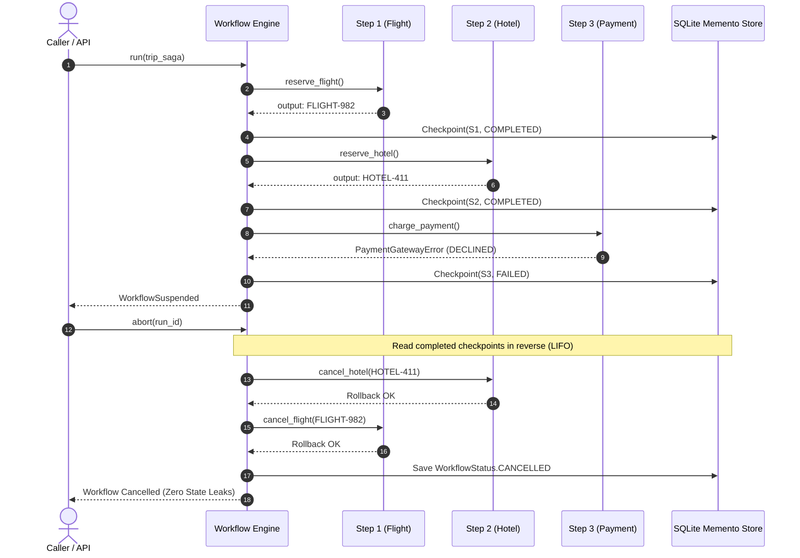

# Resilient Saga Compensation & Rollbacks

> **Architectural Pattern**: Distributed long-running transactions modeled as a sequence of forward actions with compensating rollback handlers.

---

## 🏛️ Architecture & Sequence

When orchestrating multi-stage business operations spanning multiple storage systems, message brokers, or external third-party APIs (e.g. travel booking, e-commerce checkout), distributed 2-Phase Commit (2PC) is often brittle and unavailable.

Hexaflow implements the **Saga Pattern**:
1. Every forward step registers an optional `compensation` callable.
2. Step actions execute in dependency order, persisting checkpoint records to the configured state store upon completion.
3. If an unrecoverable failure occurs mid-flight, the workflow transitions to `SUSPENDED`.
4. Calling `wf.abort(run_id)` or `hexaflow abort <run_id> <target>` inspects all completed checkpoints and unwinds their compensations in **exact reverse completion order (LIFO)**.



---

## 💻 Python Example

```python
from hexaflow.dsl.builder import Workflow
from hexaflow.domain.state import StepContext

def reserve_flight(ctx: StepContext) -> dict:
    return {"reservation_id": "FLIGHT-982", "passenger": "Alice"}

def cancel_flight(ctx: StepContext) -> None:
    res_id = ctx.output.get("reservation_id")
    print(f"Cancelling flight {res_id}")

def reserve_hotel(ctx: StepContext) -> dict:
    return {"booking_id": "HOTEL-411", "guest": "Alice"}

def cancel_hotel(ctx: StepContext) -> None:
    booking_id = ctx.output.get("booking_id")
    print(f"Cancelling hotel booking {booking_id}")

def charge_payment(ctx: StepContext) -> None:
    raise RuntimeError("Payment card authorization failed")

trip_saga = Workflow("trip-booking-saga")

trip_saga.stage("flight_reservation")
@trip_saga.step("reserve_flight", compensation=cancel_flight)
def step_flight(ctx: StepContext):
    return reserve_flight(ctx)

trip_saga.stage("hotel_booking")
@trip_saga.step("reserve_hotel", compensation=cancel_hotel, depends_on=("reserve_flight",))
def step_hotel(ctx: StepContext):
    return reserve_hotel(ctx)

trip_saga.stage("payment_processing")
@trip_saga.step("charge_payment", depends_on=("reserve_hotel",))
def step_payment(ctx: StepContext):
    return charge_payment(ctx)
```

---

## 🎬 Verified Interactive Demo

| Asset | Link |
|---|---|
| **Recording (.webm)** | [`hexaflow-saga-compensation.webm`](../assets/demos/hexaflow-saga-compensation.webm) |
| **WebVTT Captions** | [`hexaflow-saga-compensation.vtt`](../assets/demos/hexaflow-saga-compensation.vtt) |
| **Test Suite** | [`tests/e2e/test_saga_compensation.py`](../../tests/e2e/test_saga_compensation.py) |
